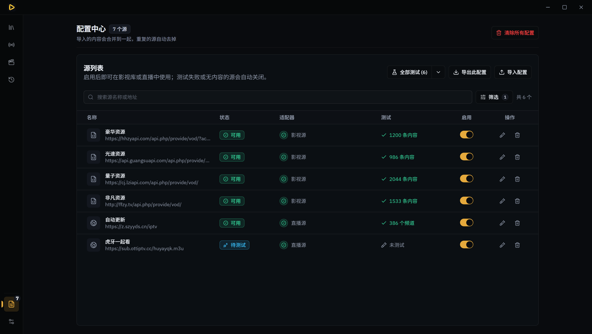
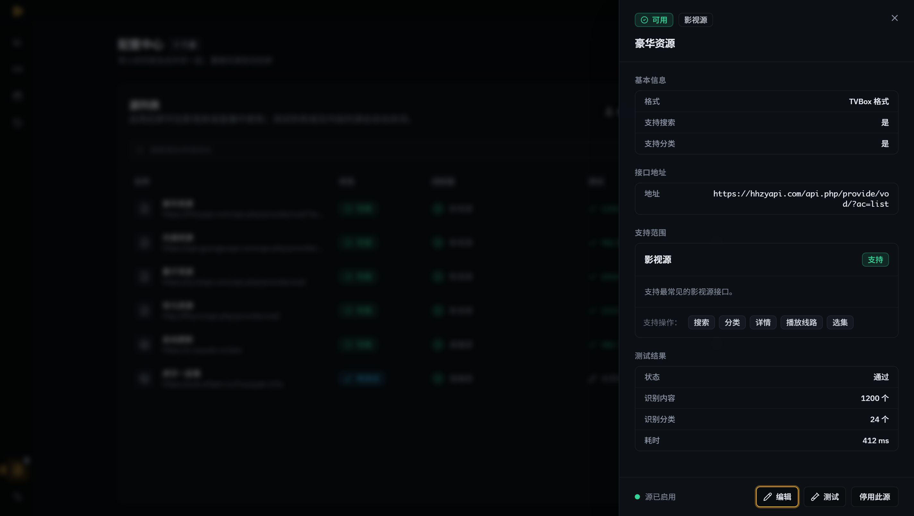
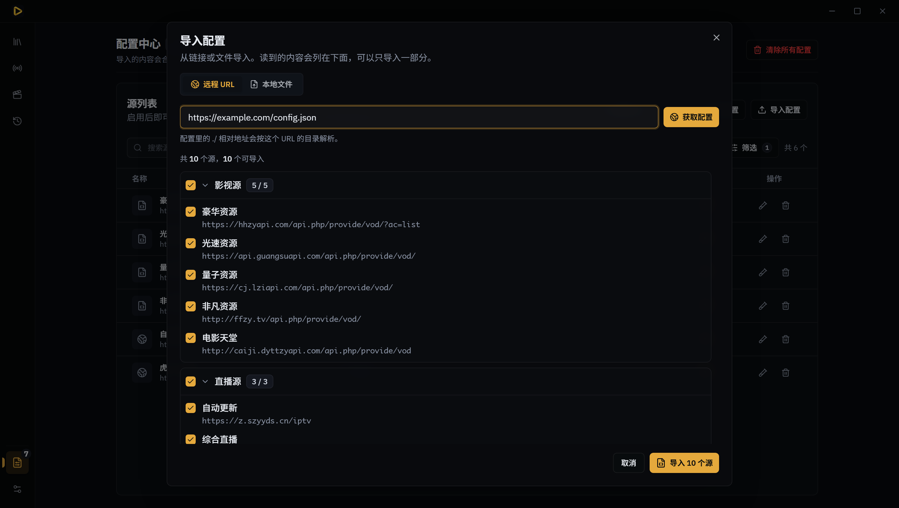
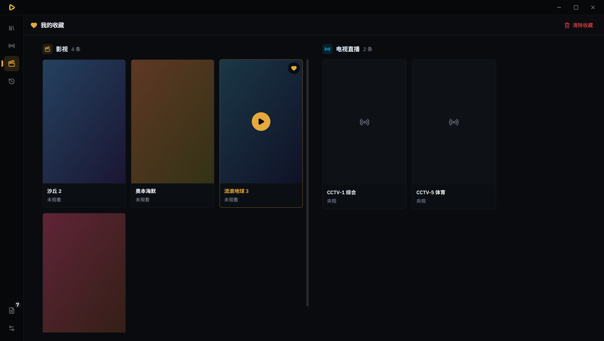

# Moseek · 拾影

English · [简体中文](README.md)

A Windows desktop player for TVBox / CatVod-style configurations: import one config file, and browse
a film library and live TV. **Runs declarative configurations only — no remote scripts, JARs, or
spiders are ever executed.**


## Features

- **Movies & live TV** — CMS catalogue browsing and search; grouped live channels with HLS and FLV
  playback.
- **Honest source grading** — every source is classified on import: usable ones work, unusable ones
  say why. Nothing is dropped silently.
- **Import what you see** — a configuration is listed before it lands (films / live / resolvers);
  you tick what you want.
- **One configuration** — repeated imports merge and deduplicate into a single document. Favourites,
  footprints and playback progress are stored separately from configurations.
- **All network traffic goes through Rust** — pages, guides, media streams and posters all pass one
  policy gateway; the webview never contacts a media host directly.

## Screenshots

| | |
|---|---|
|  |  |
| Configuration: sources, tests, enablement | Source detail: read-only, with edit on demand |
|  |  |
| Import: list first, tick, then import | Favourites & footprints: pick up where you left off |

## Download

Grab the Windows installer (NSIS) from [Releases](https://github.com/aeroray/Moseek/releases).
The app checks for updates on GitHub Releases and offers them in-app.

## Building from source

You need [Node.js](https://nodejs.org) 22+, [pnpm](https://pnpm.io) 11+ and [Rust](https://rustup.rs).

```bash
pnpm install
pnpm tauri dev     # run in development
pnpm tauri build   # produce the installer (src-tauri/target/release/bundle/)
```

Other commands: `pnpm test` (unit tests), `pnpm lint`, `pnpm typecheck`, `pnpm build` (frontend only).

## What it does not do

- It does not execute remote scripts, JARs or spiders — such sources are identified and **refused**,
  not silently broken.
- No mobile platforms.
- It ships no sources. Without a configuration file it has nothing to play; use one you obtained
  legitimately.

## Tech stack

Tauri 2 · Rust · React 19 · TypeScript · Tailwind CSS 4 · shadcn/ui · Plyr / hls.js / mpegts.js

## License

[MIT](LICENSE)
