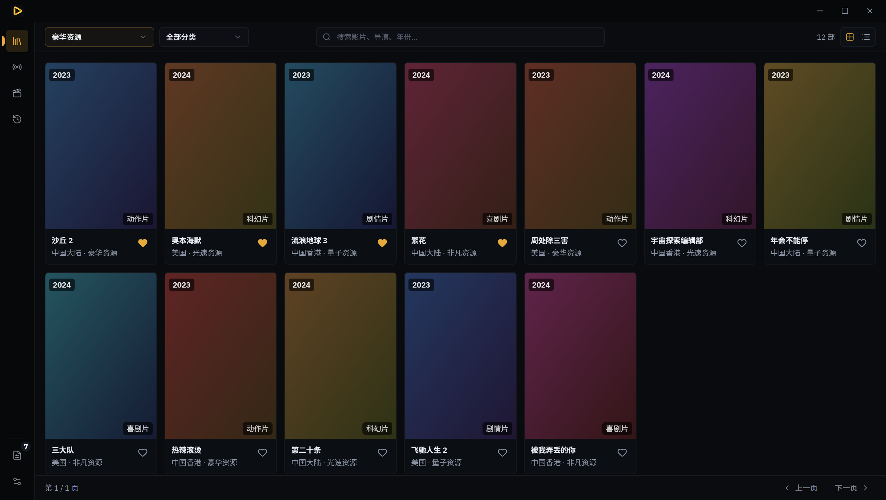

# Moseek · 拾影

[](LICENSE)
[](#download)

[简体中文](README.zh-CN.md) · English

A desktop player for TVBox / CatVod-style configurations: import one config file, then watch movies
and live TV. **Nothing in a configuration is ever executed — remote scripts, JARs and spiders are
refused.**



## Features

- **Movies and live TV** — category browsing, search and episode selection; grouped channels, TV
  guides and per-line testing. HLS and FLV both play.
- **Sources are identified before they are used** — every source is classified on import: working
  sources work, broken ones say why. Nothing is dropped silently.
- **See it before you import it** — a configuration is listed in full first (films / live / resolvers);
  you tick what you want.
- **One configuration** — repeated imports merge and deduplicate. Favourites, footprints and playback
  progress are stored separately from configurations.
- **One network gate** — all traffic passes a Rust layer that refuses loopback, private-range and
  dangerous-scheme addresses.

## Download

Windows installer (NSIS) from [Releases](https://github.com/aeroray/Moseek/releases). The app checks
for updates on GitHub Releases and offers them in-app.

## Build from source

Requires [Node.js](https://nodejs.org) 22+, [pnpm](https://pnpm.io) 11+ and
[Rust](https://rustup.rs).

```bash
pnpm install
pnpm tauri dev     # run in development
pnpm tauri build   # produce the installer in src-tauri/target/release/bundle/
```

Other scripts: `pnpm test` (unit tests), `pnpm lint`, `pnpm typecheck`, `pnpm build` (frontend only).

## Scope

- Desktop only — Windows today, macOS planned. No mobile platforms.
- No sources are bundled. You need your own configuration file, obtained legitimately.

## Tech stack

Tauri 2 · Rust · React 19 · TypeScript · Tailwind CSS 4 · shadcn/ui · Plyr / hls.js / mpegts.js

## Contributing

Bug reports and ideas are welcome via [Issues](https://github.com/aeroray/Moseek/issues).

## License

[MIT](LICENSE)
